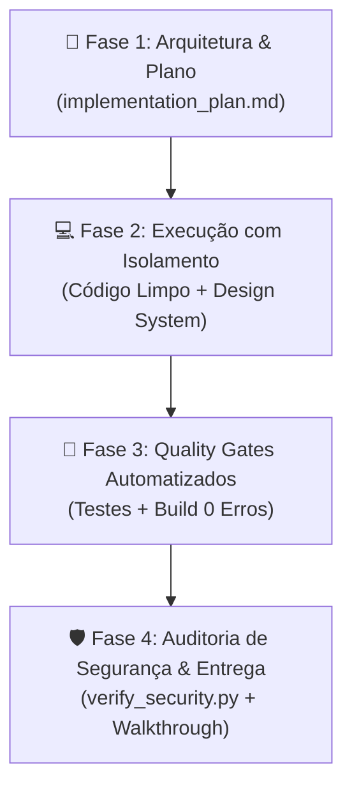

# 👥 Orquestração e Colaboração Multi-Agentes no Antigravity

Este documento padroniza a dinâmica de colaboração entre subagentes, divisão de papéis e regras de comunicação para novos projetos.

---

## 1. O Papel do Agente Principal (Lead Architect)
O agente principal funciona como o **Tech Lead / Coordenador Geral**. Ele é responsável por:
1. Receber o pedido do usuário e quebrar em etapas lógicas.
2. Criar ou validar o plano em `implementation_plan.md`.
3. Delegar tarefas especializadas aos subagentes quando a tarefa exigir profundidade ou testes extensos.
4. Executar os Quality Gates antes de entregar ao usuário.

---

## 2. Especialistas Pré-definidos e Quando Invocar

| Subagente | Modelo Recomendado | Responsabilidade Central | Quando Chamar |
| :--- | :--- | :--- | :--- |
| **`Codebase Researcher`** | `flash` ou `research` | Leitura de repositório, análise de APIs, schemas do banco e documentação técnica. | Antes de iniciar refatorações em arquivos grandes ou ao integrar novas bibliotecas. |
| **`Feature Implementer`** | `inherit` ou `pro` | Escrita de código limpo em TypeScript, criação de componentes React e Server Actions. | Para desenvolvimento focado de componentes e páginas inteiras. |
| **`QA Test Engineer`** | `flash` | Execução de testes automatizados, simulação de telas mobile (320px) e testes de estresse. | Após a implementação e antes da aprovação final. |
| **`Security Gatekeeper`** | `flash` | Varredura de credenciais, checagem de variáveis de ambiente e verificação de regras RLS. | Imediatamente antes de qualquer commit ou ao manipular senhas/chaves. |

---

## 3. Fluxo de Trabalho em 4 Fases Obrigatório

### Regras de Interação entre Agentes:
1. **Passagem de Bastão (Handoff Limpo):**
   - Ao delegar para um subagente, o prompt deve conter: contexto claro, caminho dos arquivos afetados e critério de aceitação objetivo.
2. **Sem Suposições:**
   - Se uma regra de negócio ou chave estiver ausente, pergunte explicitamente ao usuário em vez de criar mocks fixos no código.
3. **Não poluir o contexto principal:**
   - Tarefas que exigem varrer centenas de linhas de logs ou dezenas de arquivos devem ser delegadas a um subagente `research` ou `flash`.
