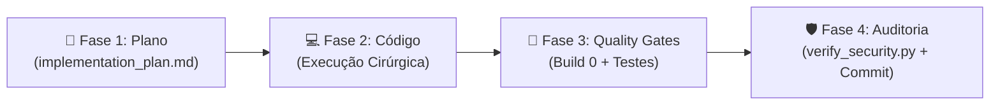

# 🤖 ReviseAI - Diretrizes de Engenharia, Qualidade & Governança (Antigravity)

> **Este arquivo é lido automaticamente pelo Antigravity em todas as sessões.**
> Todos os agentes e subagentes operando neste repositório devem seguir rigorosamente este fluxo.

---

## 🎯 1. Visão Geral da Arquitetura & Stack
- **Frontend / Mobile:** Next.js 14+ (App Router), TypeScript estrito, Tailwind CSS, PWA com Service Worker (`frontend/`).
- **Design System:** Estilo Fintech (PicPay/Nubank) — Fundo Preto Puro (`#000000`), Cartões Neutros (`#141414`), Verde Sólido (`#11C76F`), zero degradês, tipografia arredondada, zero `alert()` de navegador (usar `ToastContext`).
- **Banco de Dados & Autenticação:** Supabase PostgreSQL com Row Level Security (`public.profiles`, `public.study_sessions`, `public.subjects`, `public.error_notebook`).
- **IA Pedagógica:** Google GenAI SDK (`gemini-2.5-flash` / `gemini-2.0-flash`) com fallbacks determinísticos e sanitização anti-prompt injection.

---

## 🛡️ 2. Políticas Arquiteturais Invioláveis

### 🚫 Regra 1: ZERO Autenticação Fake / Mock
- **É ESTRITAMENTE PROIBIDO** simular login ou multi-usuários usando `localStorage` e arrays estáticos (ex: `DEFAULT_DEMO_USER`).
- Toda funcionalidade de autenticação, cadastro e sessão DEVE utilizar o **Supabase Auth real** (`supabase.auth.signUp`, `signInWithPassword`, `signOut`, `getSession`) sincronizado com a tabela `public.profiles` via RLS (`auth.uid() = id`).
- Planos SaaS (Free, Plus, Pro) devem ser refletidos na coluna `plan` de `public.profiles`, e não em variáveis locais fictícias.

### 🚫 Regra 2: Anti-Monólito (Arquivos com Máximo 400 Linhas)
- **É ESTRITAMENTE PROIBIDO** concentrar múltiplas telas, modais e lógicas em um único arquivo gigante (ex: `app/page.tsx` com 1.000 linhas).
- Cada aba ou funcionalidade principal DEVE ser extraída para seu componente modular correspondente em `frontend/components/` (ex: `ActiveStudyTab.tsx`, `ErrorNotebookTab.tsx`, `GradebookTab.tsx`, `RoutinesTab.tsx`).

### 🚫 Regra 3: Menus Limpos no Padrão Fintech (Zero Botões Improvisados)
- A barra de navegação superior (Header) deve ser limpa, consistente e elegante:
  - Exibir apenas: Logotipo, identificador do plano (badge discreta), meta do estudante e avatar do usuário com menu drop-down / modal para Configurações, Plano e Logout.
  - PROIBIDO botões soltos de "trocar de conta fake" ou badges gigantes desarmônicos.

### 🚫 Regra 4: Política de Segurança Absoluta (Zero-Leak)
- Nenhuma chave (`AIzaSy...`), segredo (`sb_secret_...`) ou senha pode ser colocada em código rastreado pelo Git.
- O repositório possui pre-commit hook ativo rodando `python scripts/verify_security.py`.

---

## 🚀 3. Pipeline de Desenvolvimento em 4 Fases (Obrigatório por Demanda)

Toda melhoria, refatoração ou correção deve seguir este ciclo:



### Fase 1: Arquitetura & Plano (`implementation_plan.md`)
- Se a demanda envolver mudanças estruturais ou de banco, crie o plano detalhado antes de codificar.
- Mapeie arquivos impactados, compatibilidade móvel (320px) e segurança de RLS no Supabase.

### Fase 2: Implementação com Isolamento Cirúrgico
- Desenvolva a funcionalidade respeitando a arquitetura modular e mobile-first.
- Todas as notificações ao estudante devem usar `showToast(msg, 'success' | 'error' | 'info')`.
- Modais DEVEM usar `<Portal>` e `useBodyScrollLock` para não travar o scroll de fundo em celulares.

### Fase 3: Portões de Qualidade Automatizados (Quality Gates)
O agente deve rodar e garantir **100% de sucesso**:
```bash
# 1. Build de produção do Next.js
cd frontend && npm run build

# 2. Suíte consolidada de testes automatizados
node tests/core_coverage.test.js
```

### Fase 4: Auditoria de Segurança & Entrega
1. Executar `python scripts/verify_security.py` para garantir zero segredos no diff.
2. Realizar o commit semântico (`feat:`, `fix:`, `refactor:`) e push para a branch `main`.

---

## 👥 4. Como os Agentes Especialistas se Dividem

| Especialista | Papel Principal | Quando Chamar |
| :--- | :--- | :--- |
| **`Lead Architect`** | Desenha o plano, contratos de dados e tabelas Supabase. | Início de qualquer nova funcionalidade ou refatoração. |
| **`Feature Implementer`** | Constrói componentes React, formulários e Server Actions cirúrgicos. | Para implementar o código modular. |
| **`QA Test Engineer`** | Roda `npm run build`, simula telas de 320px e escreve testes automatizados. | Para validar antes de finalizar a tarefa. |
| **`Security Gatekeeper`** | Roda `verify_security.py` e audita políticas RLS e injeção de IA. | Antes de qualquer commit ou alteração de auth. |
