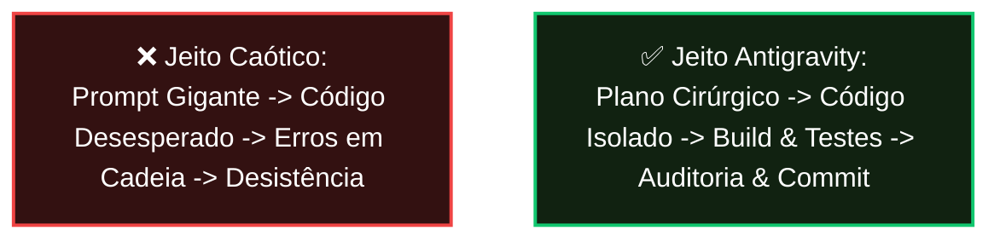
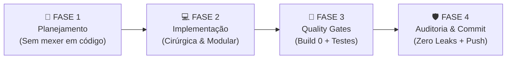

# 🧠 Guia Definitivo: Como Pensar e Construir Projetos com Agentes de IA

> **"A maioria dos projetos com IA falha não pela falta de capacidade do modelo, mas pela ausência de governança e rédeas de engenharia."**

Se você já tentou abrir um projeto novo com IA e sentiu que **nada funcionava**, as dependências quebravam, os arquivos eram reescritos do zero de forma desastrosa ou o código vivia com erros de compilação, você não está sozinho.

Neste projeto (**Coach AI / kind-raman**), criamos mais de **69 testes automatizados**, dezenas de componentes complexos, integração Stripe, Strava, Supabase e Gemini com **zero vazamentos de segredos e zero quebras**.

Abaixo está o **método exato**, o **modelo mental** e o **passo a passo prático** para reproduzir esse mesmo nível de maestria em qualquer projeto que você for criar.

---

## 🧭 PARTE 1: O Modelo Mental (Por que projetos normais falham?)

Quando um desenvolvedor pede à IA:
> ❌ *"Crie um aplicativo completo de finanças com login, banco de dados e gráficos."*

Acontece o **Efeito Avalanche**:
1. A IA tenta inventar 30 arquivos ao mesmo tempo.
2. Ela instala bibliotecas conflitantes (ex: misturar Tailwind v3 com Tailwind v4, ou App Router com Pages Router).
3. Ela não testa se o código compila.
4. Quando surge o primeiro erro, você pede para corrigir e ela **reescreve o arquivo inteiro**, apagando o que já funcionava e criando 3 novos bugs.
5. Em 20 minutos, o projeto está completamente quebrado e você tem vontade de recomeçar.

### 💡 A Regra de Ouro da Engenharia com IA
> **A IA não é uma fábrica que entrega um prédio pronto. A IA é um time de pedreiros ultra-rápidos que precisa de uma planta rigorosa, fiscalização a cada tijolo e um teste de carga antes de colocar o teto.**



---

## 🏛️ PARTE 2: Os 3 Pilares Inegociáveis de um Projeto que Funciona

Para que qualquer projeto funcione com a mesma perfeição deste, ele precisa de 3 pilares:

### Pilar 1: A "Constituição" do Projeto (`AGENTS.md`)
O arquivo `AGENTS.md` na raiz do projeto é a **leis supremas** que a IA lê antes de dar qualquer resposta. Se você não colocar o `AGENTS.md`, a IA vai agir por impulso.

O que o `AGENTS.md` deve ditar:
1. **Design System rígido:** Ex: Fundo `#000000`, cartões `#141414`, destaque `#11C76F`. Zero degradês e **proibido `alert()` do navegador**.
2. **Proibido reescrever arquivos inteiros:** Obrigue a IA a editar apenas os blocos alterados.
3. **Quality Gates obrigatórios:** A IA **não tem permissão** de dizer "pronto" sem antes rodar `npm run build` e a suíte de testes.
4. **Zero credenciais no Git:** Obrigatório rodar o scanner `verify_security.py`.

### Pilar 2: O Pipeline em 4 Fases (The Iron Pipeline)

Toda tarefa (seja um botão novo ou um sistema de pagamento inteiro) passa por estas 4 fases:



1. **Fase 1 (Plano):** A IA mapeia os arquivos impactados, desenha o fluxo e lista os riscos antes de tocar em uma única linha de código.
2. **Fase 2 (Código):** Edição pontual. Se for um componente novo, crie um arquivo isolado.
3. **Fase 3 (Testes):** Rodar `npm run build`. Se der 1 erro de TypeScript sequer, corrija antes de prosseguir.
4. **Fase 4 (Entrega):** Rodar o scanner de segurança e gerar o commit semântico (`git commit`).

### Pilar 3: O Time de Agentes Especialistas (Orquestração)

Nunca trate o agente como "uma entidade que faz tudo". Pense nele como uma empresa com 4 funcionários:

| Especialista | Papel Principal | Quando Chamar |
| :--- | :--- | :--- |
| 🕵️ **Codebase Researcher** | Lê arquivos, bibliotecas e APIs sem alterar nada. | Antes de qualquer implementação. Ele mapeia como o código atual funciona. |
| 📐 **Architect / Planner** | Cria o plano de implementação passo a passo. | Para aprovar a estratégia com você antes de codificar. |
| 💻 **Feature Implementer** | Escreve código limpo, modular e aderente ao design. | Para criar os componentes e Server Actions. |
| 🧪 **QA & Security Gatekeeper** | Roda o build, escreve testes e verifica segredos. | Antes de finalizar a demanda ou comitar. |

---

## 🛠️ PARTE 3: O Passo a Passo "Day Zero" (Como Iniciar um Projeto do Zero)

Siga este roteiro rigorosamente sempre que for criar um novo projeto. Ele garante que o projeto nasça com **90% da fundação blindada**:

### Passo 1: Inicialize o Git e os Guardiões de Segurança
No terminal:
```bash
mkdir meu-novo-app
cd meu-novo-app
git init
```

Copie os scripts de segurança da nossa skill:
```bash
# Copia o scanner e o instalador de hook
python scripts/setup_git_hook.py
```
> **Por que fazer isso agora?** Porque a partir do segundo 1, ninguém conseguirá vazar senhas ou tokens sem que o Git barre o commit.

### Passo 2: Scaffold Limpo do Next.js 14
Crie o projeto Next.js com a estrutura padronizada:
```bash
npx create-next-app@latest frontend --typescript --tailwind --eslint --app --src-dir=false --import-alias="@/*"
```

### Passo 3: Criar a Constituição do Projeto (`AGENTS.md`)
Crie o arquivo `AGENTS.md` na raiz do seu novo projeto. Você pode copiar o modelo do Coach AI, ajustando o nome do projeto e a stack. 

### Passo 4: Instalar os Blocos Fundamentais (Templates da Skill)
Importe diretamente os templates da nossa skill `antigravity-project-blueprint`:
1. `ToastContext.tsx`: Notificações elegantes desde o primeiro dia.
2. `Portal.tsx` & `useBodyScrollLock.ts`: Para que modais mobile nunca quebrem a rolagem.
3. `tailwind.config.ts`: Paleta Fintech oficial (`#000000`, `#141414`, `#11C76F`).
4. `supabase_schema.sql`: Execute no SQL Editor do Supabase para criar a tabela de usuários com RLS estrito.

---

## 🎯 PARTE 4: Como Falar com a IA (Prompts de Ouro vs Prompts Proibidos)

A forma como você comanda a IA dita 100% da estabilidade do código:

### ❌ O Jeito Proibido (Gera bugs e código quebrado):
> *"O botão de login não está funcionando, conserta aí."*
> 
> **Resultado:** A IA vai refatorar o componente inteiro, trocar a biblioteca de login, estragar o design e criar 5 novos erros.

### ✅ O Jeito Cirúrgico (Gera código de produção):
> *"Analise o arquivo `frontend/components/LoginForm.tsx`. O envio está retornando erro 400. Siga o pipeline em 4 fases: primeiro me mostre onde está o erro no console/payload; depois proponha uma correção cirúrgica sem alterar a estrutura visual do formulário; ao final, valide com `npm run build`."*
> 
> **Resultado:** A IA isola o bug, faz uma alteração de 3 linhas, compila o build e te entrega o código 100% funcional.

---

## 📋 PARTE 5: Cheat Sheet de Comandos e Prompts Prontos

Guarde estes prompts para usar no dia a dia:

### 1. Para iniciar uma funcionalidade complexa:
> *"Quero implementar a funcionalidade [X]. Não escreva código ainda. Atue como Arquiteto de Software e elabore um plano de implementação detalhando: 1) Arquivos a criar/modificar; 2) Impacto no banco de dados; 3) Compatibilidade mobile (320px); 4) Possíveis riscos. Aguarde meu 'proceder' antes de codificar."*

### 2. Para debugar um erro persistente:
> *"Ocorreu o erro [COLAR ERRO AQUI]. Não reescreva arquivos inteiros. Localize a linha exata da falha, explique a causa raiz em 2 frases e faça uma substituição mínima apenas no bloco afetado. Em seguida, rode o build de validação."*

### 3. Para auditar antes de subir para produção:
> *"Atue como QA e Security Gatekeeper. Execute: 1) Build de produção do Next.js; 2) Suíte de testes automatizados; 3) Scanner de segurança `verify_security.py`. Me entregue o relatório com a contagem de testes e status de cada portão."*

---

## 🏁 Conclusão: O Segredo do Sucesso

Projetos não funcionam por mágica ou sorte. Eles funcionam porque:
1. **O escopo é pequeno e controlado.**
2. **A arquitetura é modular** (componentes isolados, modais via Portal, estado com Context).
3. **O build é executado a cada mudança** (nenhum erro dorme no repositório).
4. **O `AGENTS.md` mantém a IA na linha.**

Agora você tem todo esse conhecimento documentado e as ferramentas prontas na skill global `antigravity-project-blueprint`!
